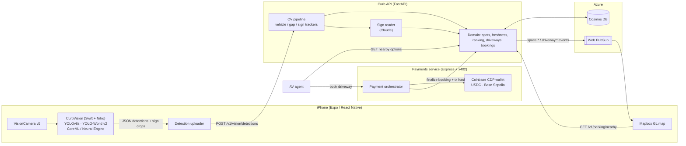

# Curb

**A live map of street parking, built by phones, readable by people and autonomous vehicles.**

Built at Cal Hacks 13 (October 2026).

Parking in dense cities is a shared, scarce resource, and it gets harder as AV fleets compete for the same curb. Curb turns every phone on a dashboard into a parking sensor. Phones detect open curb space and parking signs on-device, the server confirms and ages those observations, and the result is one shared map that drivers browse in the app and AV agents query over the API.

---

## How it works

1. **The phone scans.** While you drive, the camera runs two CoreML models on the iPhone's Neural Engine. **YOLOv8s** detects vehicles (car, motorcycle, bus, truck), and **YOLO-World v2** detects parking-related signs using open-vocabulary prompts ("no parking sign", "parking meter", …).
2. **Only metadata leaves the device.** The app sends bounding boxes, classes, confidence, GPS, and heading as JSON to `POST /v1/vision/detections`. Full frames never leave the phone. The only image data uploaded is small JPEG crops of detected signs.
3. **The server finds gaps.** A vehicle tracker and a gap tracker look for open space between parked cars across successive frames. A gap is confirmed only after it persists over time.
4. **Signs become rules.** The sign tracker triangulates sign poles. The best crop goes to Claude, which reads the text and turns it into structured parking rules.
5. **Spots age out.** Confirmed spots are stored as GeoJSON per road segment, and their freshness decays: green when seen within 90 s, yellow within 3 min, gray within 5 min, then expired. A maintenance task expires stale spots every second, and marking a spot occupied takes conservative multi-frame evidence.
6. **Everyone sees it live.** Changes are broadcast over Azure Web PubSub, so every connected phone's map updates in real time.
7. **AVs use the same data.** Agents read nearby options from the same API. Private driveways can be held and booked, and booking payment settles on-chain through Coinbase's **x402** protocol (USDC on Base Sepolia).

## Architecture



### Why the CV runs on-device

We started with server-side inference: we streamed frames to GPU hosts (Azure, AWS EC2, Google Colab, and rented RTX 4090s). Network latency capped the pipeline at about 5 fps, and renting a bigger GPU didn't help. Moving both models onto the phone and sending only detections removed the bottleneck. It also cut bandwidth, kept camera footage private, and made compute scale with users instead of with our GPU bill.

## Repository layout

| Path | What it is |
| --- | --- |
| `mobile/` | Expo SDK 58 / React Native 0.88 iOS app. Mapbox GL map in a WebView, plus native scanner, sheets, and booking flow. |
| `mobile/modules/curb-vision/` | Swift/Nitro native module that runs both CoreML models on camera buffers |
| `mobile/scripts/export-coreml-models.py` | Pinned exporter: YOLOv8s-seg + YOLOv8m-worldv2 → `.mlpackage` |
| `server/` | FastAPI backend: CV pipeline, trackers, sign reading, spot lifecycle, driveways, bookings, realtime |
| `server/app/cv/` | Vehicle/gap/sign tracking, sign localization, confidence, Claude sign reader |
| `server/app/domain/` | Parking spots, freshness, ranking, driveway state machine, bookings |
| `server/deploy/` | Azure VM + nginx deployment scripts |
| `payments/` | Express service: x402 receipts, Coinbase CDP wallet, exactly-once payment orchestration |
| `packages/contracts/` | Shared TypeScript API, domain, and realtime-event types |
| `ON_DEVICE_CV.md` | Full on-device CV build, privacy contract, and spot lifecycle details |
| `AV-DRIVEWAY-DEMO.md` | Walkthrough of the AV booking demo |

## Key API endpoints

| Method | Route | Purpose |
| --- | --- | --- |
| `POST` | `/v1/vision/detections` | Submit on-device detections (JSON, bounded payload) |
| `GET` | `/v1/parking/nearby` | Ranked nearby spots and driveways (GeoJSON geometry) |
| `GET` | `/v1/spaces/{space_id}` | Spot detail, including sign rules and confidence |
| `GET` | `/signs/rules-here` | Parking rules that apply at a location |
| `POST` | `/v1/driveways/{id}/holds` | Hold a private driveway |
| `POST` | `/v1/payments/{bookingId}/execute` | Pay for a held booking over x402 (payments service) |
| `POST` | `/v1/realtime/negotiate` | Get a Web PubSub connection for live map events |
| `POST` | `/v1/agent/run-demo` | Run the AV driveway demo |
| `GET` | `/v1/debug/state` | Tracker state and recent spot transitions |

## Map legend

| Color | Meaning |
| --- | --- |
| Green | Likely open (seen ≤ 90 s ago) |
| Yellow | May still be open (≤ 3 min) |
| Gray | Stale observation (≤ 5 min) |
| Blue line | Legal zone, availability unknown |
| Purple | Private driveway, reservable with payment |

## AV demo

```sh
curl -X POST localhost:8000/v1/agent/run-demo
```

A blue AV marker drives about 220 m to a seeded driveway. It holds the driveway and pays $5.00 in USDC through x402, which is a real on-chain transaction on Base Sepolia. The driveway then turns gray ("Booked $5.00") on every connected phone. See [`AV-DRIVEWAY-DEMO.md`](AV-DRIVEWAY-DEMO.md).

## Running locally

**Server** (Python 3.11):

```sh
cd server
cp .env.example .env        # Cosmos, Web PubSub, Anthropic keys (falls back to in-memory store)
pip install -r requirements.txt
uvicorn app.main:app --reload --port 8000
```

**Payments** (Node 24):

```sh
npm ci                      # from repo root (npm workspaces)
cd payments && cp .env.example .env   # CDP API keys, wallet, x402 facilitator, Base Sepolia RPC
npm start
```

**Mobile** (macOS, Xcode 26.4+, a physical iPhone for camera inference):

```sh
cd mobile && cp .env.example .env     # Mapbox token + device-reachable API URL
uv run --python 3.11 scripts/export-coreml-models.py
CI=1 npx expo prebuild --clean --platform ios
npx expo run:ios --device
```

Expo Go can't load the custom native vision module, so you need a native development build. See [`ON_DEVICE_CV.md`](ON_DEVICE_CV.md) for signing, model export, and troubleshooting.

## Tech stack

- **Mobile:** Expo, React Native, VisionCamera v5, Nitro Modules, Swift, CoreML, Mapbox GL JS
- **Models:** Ultralytics YOLOv8s (vehicles) and YOLOv8m-World v2 (signs, open-vocabulary via CLIP)
- **Server:** FastAPI, Pydantic, NumPy, Anthropic (Claude sign reading)
- **Cloud:** Azure Cosmos DB, Azure Web PubSub, Azure VM + nginx
- **Payments:** Express, x402 (`@x402/*`), Coinbase CDP SDK, USDC on Base Sepolia

## Limitations

- Only the iOS build runs on-device inference. Android and web are preview-only.
- A spot is tracked per directional road segment, not per individual stall.
- Gap detection doesn't yet measure whether a vehicle fits or whether a spot is legal to park in.
- Payments run on testnet (Base Sepolia).
